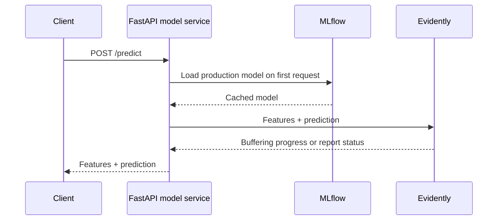

# API Setup

This step focuses on the prediction API. The service returns taxi ride-duration predictions and forwards the same request, plus the prediction, to the monitoring service.

The FastAPI prediction service is already supplied for you to inspect.

## Request Flow



## Request and Response

Inspect [webservice/data_model.py](webservice/data_model.py). A request contains exactly three features:

```json
{
  "PULocationID": 42,
  "DOLocationID": 41,
  "trip_distance": 1.5
}
```

The response includes those fields and `prediction`, a duration estimate in minutes. Pydantic rejects missing fields, extra fields, non-finite distances, and non-positive distances.

The API remains integer-based for location IDs. [webservice/predict.py](webservice/predict.py) converts them to strings before passing the DataFrame to the saved categorical pipeline.

## Model Loading

The cached loader resolves:

```text
models:/green-taxi-ride-duration@production
```

The model is loaded once per API process. See [service addresses](04-prometheus-grafana-docker-compose.md#service-addresses) for host versus container URLs, and [model/reference alignment](01-train-and-register-local-model.md#keep-predictions-and-reference-aligned) when changing the model version.

`GET /` checks that the API is alive, not that the model is available. If model loading fails, `/predict` returns HTTP 503 with recovery instructions; train and register the model as described in chapter 01.

## Forwarding to Monitoring

Inspect [webservice/app.py](webservice/app.py). Each successful prediction will be posted to:

```text
http://evidently_service:8085/iterate/green_taxi_data
```

Delivery is synchronous and has a five-second timeout. Connection errors, timeouts, and unsuccessful monitoring responses are logged, but do not turn a successful prediction into an API failure. This simple demo can therefore serve a prediction while monitoring is unavailable, at the cost of waiting for the delivery attempt.

The API also exposes `/metrics` through the Prometheus FastAPI instrumentator. `monitoring_delivery_failures_total` counts failed delivery attempts since the API process started; HTTP 200 predictions alone do not confirm successful monitoring delivery.
