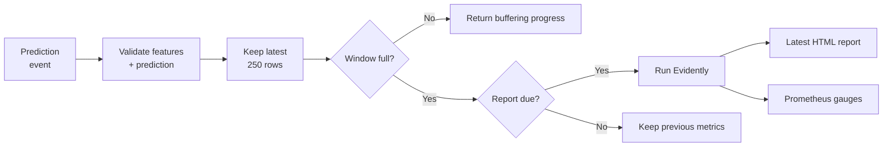

# Evidently Setup

The monitoring service also uses FastAPI. It receives validated prediction events, keeps a sliding window, compares it with the reference using Evidently, and exposes an HTML report and Prometheus metrics.

## Monitoring Flow



## Configuration

Inspect [evidently_service/config.yaml](evidently_service/config.yaml):

```yaml
column_mapping:
  categorical_features:
    - PULocationID
    - DOLocationID
  numerical_features:
    - trip_distance
  target: duration
  prediction: prediction

service:
  calculation_period_sec: 10
  reference_path: ./green_taxi_data/reference.csv
  window_size: 250
```

Evidently compares the three inputs and `prediction`. Although the reference contains historical `duration`, the explicit data definition excludes it from the drift comparison because live events do not have ground truth.

Startup reads the reference with string location IDs, creates the report, and exports a reference hash. Inspect [app.py](evidently_service/app.py) for the routes and [utils.py](evidently_service/utils.py) for report execution and metric export.

## Window and Refresh Period

The first 250 successful events produce a report. Later events keep the latest 250 rows and refresh the report at most once every ten seconds.

Reports are triggered by incoming events, not a background timer. With no traffic, the exported gauges retain the previous report's values. A new Prometheus sample does not mean a new Evidently report was computed.

`evidently_last_event_timestamp_seconds` and `evidently_last_report_timestamp_seconds` expose the last accepted event and successful report as Unix timestamps. They start at zero. Grafana displays their age using `time() - timestamp`, excluding zero values until the first event or report.

The service runs one Uvicorn worker, with a lock protecting its shared window. Additional workers would create separate windows; scaling this demo requires durable shared state first. Restarting the service empties its window.

## Read the Metrics Correctly

| Metric | Meaning |
|---|---|
| `evidently_valuedrift_prediction` | Normalized Wasserstein distance between reference and current predictions. |
| `evidently_driftedcolumnscount_count` | Number of drifted columns out of the three inputs plus prediction. |
| `evidently_driftedcolumnscount_share` | Fraction of those four columns marked as drifted. |

Prediction drift explicitly uses Wasserstein distance with a `0.1` threshold. Higher values indicate a larger distribution change. It is not a p-value, and the threshold is a lesson default, not a universal production rule.

The dashboard shows only the drifted-column count; the share remains available in raw metrics. Missing or non-finite predictions are rejected by the event schema, not counted as accepted monitoring events.

These checks measure data and prediction drift. They do not establish concept drift or model accuracy. Error monitoring would require joining predictions with actual durations.
