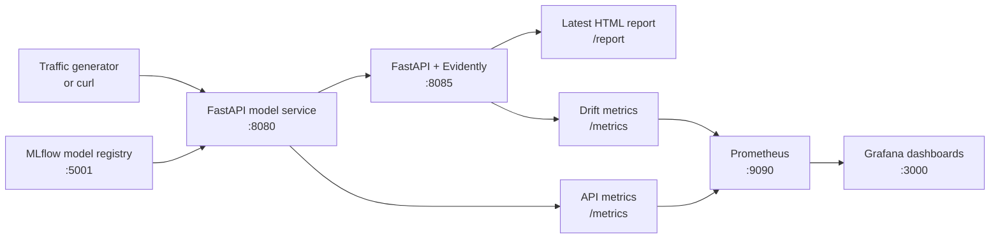

# Real-Time ML Monitoring

In this repository, you will monitor a taxi trip-duration model using FastAPI, Evidently, Prometheus, and Grafana. You register a baseline in MLflow, replay historical requests, then inspect prediction drift and API metrics in a local Docker Compose stack.

All services and configuration are supplied. Focus on following the data, interpreting the metrics, and finding the first broken link when a dashboard is empty.

## Learning Objectives

By the end of this repository, you should be able to:

- Bootstrap a local model registry entry and alias.
- Configure an Evidently reference dataset and sliding current-data window.
- Expose model monitoring metrics for Prometheus to scrape.
- Use Grafana and the Evidently HTML report together when interpreting drift.
- Debug the monitoring loop from the API outward instead of starting at the dashboard.
- Explain how prediction requests become monitoring events.
- Identify practical next steps for making this demo pattern production-ready.

## Learning Path

| File / Folder | Description |
|---|---|
| [**01 - Train and Register the Local Model**](01-train-and-register-local-model.md) | Train the three-feature baseline, register it in MLflow, and refresh the reference predictions. |
| [**02 - API Setup**](02-API-set-up.md) | Inspect the prediction schema, model loading, and monitoring delivery. |
| [**03 - Evidently Setup**](03-evidently-set-up.md) | Understand the reference dataset, sliding window, and exported metrics. |
| [**04 - Prometheus, Grafana, and Docker Compose**](04-prometheus-grafana-docker-compose.md) | Start the services and inspect their connections. |
| [**05 - Run and Interpret the Monitoring Loop**](05-run-and-interpret-monitoring.md) | Replay requests, inspect the dashboards, and run a controlled drift experiment. |
| [**06 - Operate and Extend Monitoring (Optional)**](06-OPTIONAL-operate-and-extend-monitoring.md) | Tune the window, debug failures, and discuss production limitations. |

### Additional Folders and Files

| File / Folder | Description |
|---|---|
| [**webservice**](webservice/) | FastAPI prediction service and shared event schemas. |
| [**evidently_service**](evidently_service/) | FastAPI monitoring service, configuration, and bundled reference data. |
| [**prometheus**](prometheus/) | Scrape targets and a service-down alert rule. |
| [**grafana**](grafana/) | Provisioned data source and two dashboards. |
| [**train_and_register_model.py**](train_and_register_model.py) | Baseline training, MLflow registration, and reference regeneration. |
| [**send_data.py**](send_data.py) | Replay filtered taxi trips as prediction requests. |
| [**docker-compose.yaml**](docker-compose.yaml) | The five-service local stack. |
| [**pyproject.toml**](pyproject.toml) | Project configuration and dependencies. |
| [**uv.lock**](uv.lock) | Dependency lock file. |

## Monitoring Flow



> [!IMPORTANT]
> This is a historical replay, not a pickup-time prediction product. TLC's `trip_distance` is the completed trip's taximeter distance. A real pickup-time model would need an estimated distance available before the trip.

## Local Data Services

| Service | Local URL |
|---|---|
| MLflow | <http://localhost:5001> |
| Prediction API / Swagger UI | <http://localhost:8080/docs> |
| Evidently report | <http://localhost:8085/report> |
| Prometheus targets | <http://localhost:9090/targets> |
| Grafana | <http://localhost:3000> |

Grafana's initial local login is `admin` / `admin`. These services and default credentials are for local learning, not public deployment.

## Prerequisites

- **Docker Desktop**: required to run the MLflow, prediction API, Evidently, Prometheus, and Grafana containers. Follow the [installation instructions](https://docs.docker.com/get-docker/) if you do not have it yet. Make sure it is **installed and running** before you start the stack.

## Setup

> [!NOTE]
> Throughout these steps, text in angle brackets like `<repo-name>` is a **placeholder**. Replace it, including the `< >` brackets, with your own value. For example, `cd <repo-name>` becomes `cd mle-real-time-ml-monitoring`.

### 1. Use This Repository as a Template

Click **Use this template** on GitHub.

When creating the repository:

- Set yourself as the **Owner**
- Choose a repository name
- Disable **Include all branches**
- Click **Create repository**

> [!IMPORTANT]
> If you are working in pairs or groups, only **one person** should complete this step.

---

### 2. Add Collaborators (Pairs/Groups Only)

If working with teammates:

1. Open the repository on GitHub
2. Go to **Settings → Collaborators**
3. Add your teammates as collaborators
4. Share the repository link with your team

Teammates should accept the invitation before continuing.

---

### 3. Clone Your Copy

Copy the SSH URL from the **Code** button on GitHub, then run:

```bash
git clone <copied-ssh-url>
```

The copied SSH URL will look like `git@github.com:<your-username>/<repo-name>.git`.

---

### 4. Move into the Project Folder and Install Dependencies

This project uses Python 3.13. The command below installs all dependencies and creates a virtual environment in `.venv/`.

```bash
cd <repo-name>
uv sync
```

---

### 5. Create the Environment File

Copy the template once:

```bash
cp .env.example .env
```

Keep the default container URLs unless you change the service names or ports.

> [!CAUTION]
> Never commit `.env`. It is git-ignored because environment files often hold secrets. Only `.env.example`, with placeholder or default values, belongs in the repository.

---

### 6. Open the Repository in VS Code

> [!NOTE]
> Make sure you open VS Code from the project root so it automatically detects the environment created by `uv sync`.

Launch VS Code in the project root folder:

```bash
code .
```

When you open [train_and_register_model.py](train_and_register_model.py), select the Python environment created by `uv sync` as the interpreter so imports and autocompletion resolve correctly.

Run the walkthrough commands from the project root. Python commands use `uv run`, so the environment is selected automatically; no manual activation is needed.

## References & Further Reading

- [MLflow Model Registry Workflows](https://mlflow.org/docs/latest/ml/model-registry/workflow/): Register models, manage versions, and assign aliases such as `production`.
- [Evidently Reports](https://docs.evidentlyai.com/docs/library/report): Compare reference and current datasets and export HTML reports.
- [Prometheus Overview](https://prometheus.io/docs/introduction/overview/): Understand metric scraping, time series, and PromQL queries.
- [Grafana Provisioning](https://grafana.com/docs/grafana/latest/administration/provisioning/): Load data sources and dashboards from version-controlled files.
